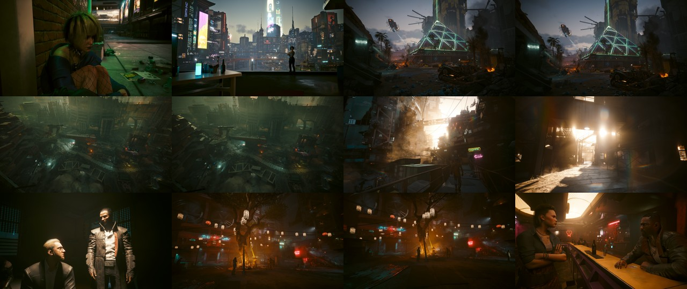
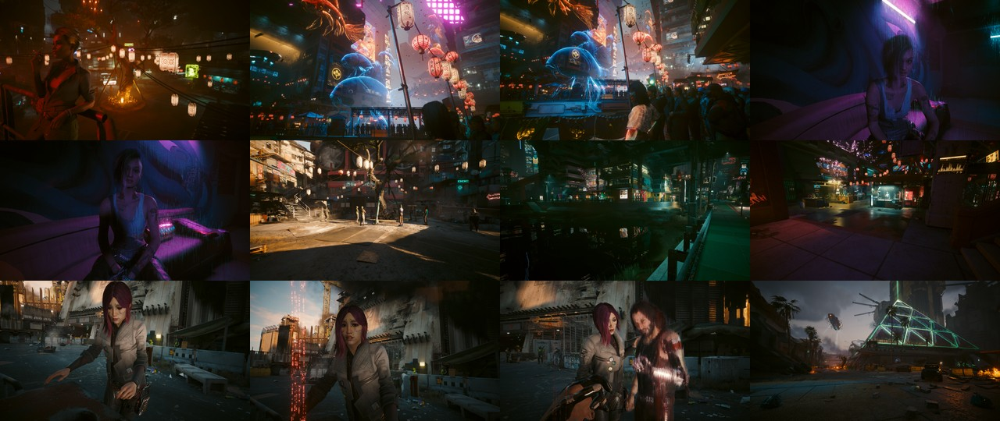
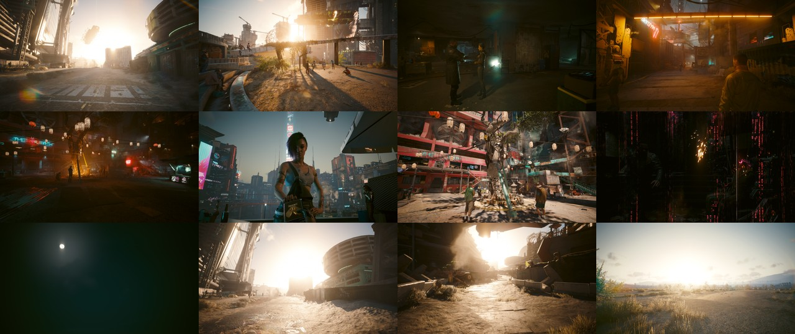
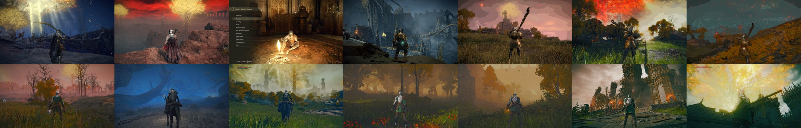
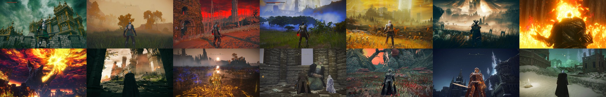
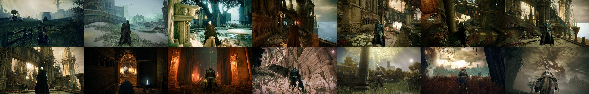
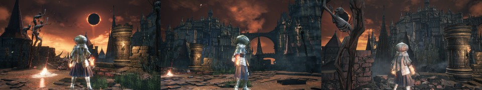
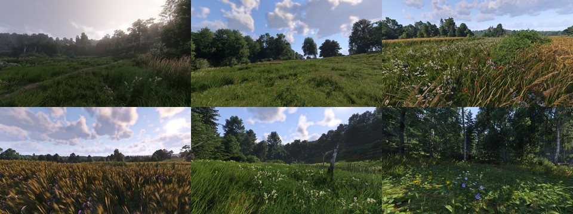
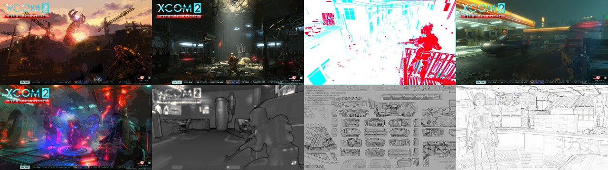

# Selected ReShade Screenshots

A public preview gallery of 99 hand-picked game screenshots across nine identified game groupings and one image whose game source remains unconfirmed. The repository contains optimized collage previews and structured catalog metadata.

[Browse the catalog](CATALOG.md) · [Structured metadata](metadata/screenshots.json)

## Preview collages

### Cyberpunk 2077

### ELDEN RING

### DARK SOULS III

### Kingdom Come Deliverance II

### XCOM 2

## Single-image sets

- Ghost of Tsushima Directors Cut
- Gothic 1 Remake
- MGS TPP
- Unidentified Game

See [CATALOG.md](CATALOG.md) for their titles and capture details.

## Notes

The XCOM 2 set includes title-screen and diagnostic captures. The catalog identifies those records directly. The Unidentified Game entry retains that classification because the available source location does not establish its game identity.

## Project directory and related work

[Browse the dastardlyrat project directory](https://dastardlyrat.github.io/).

- [reshade-preset-catalog](https://github.com/dastardlyrat/reshade-preset-catalog)
- [OpenSurface](https://github.com/dastardlyrat/OpenSurface)
- [Lazara-Reshade-Revival-Package](https://github.com/dastardlyrat/Lazara-Reshade-Revival-Package)
